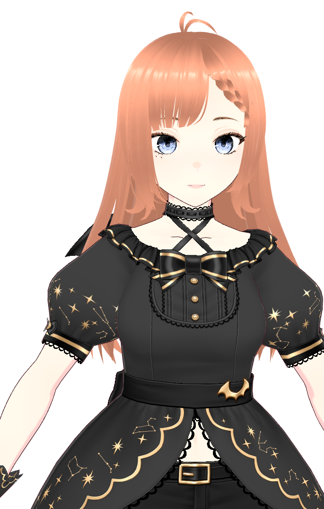
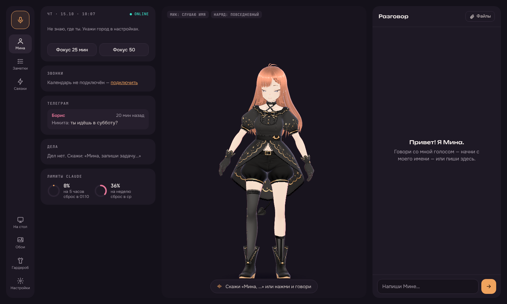
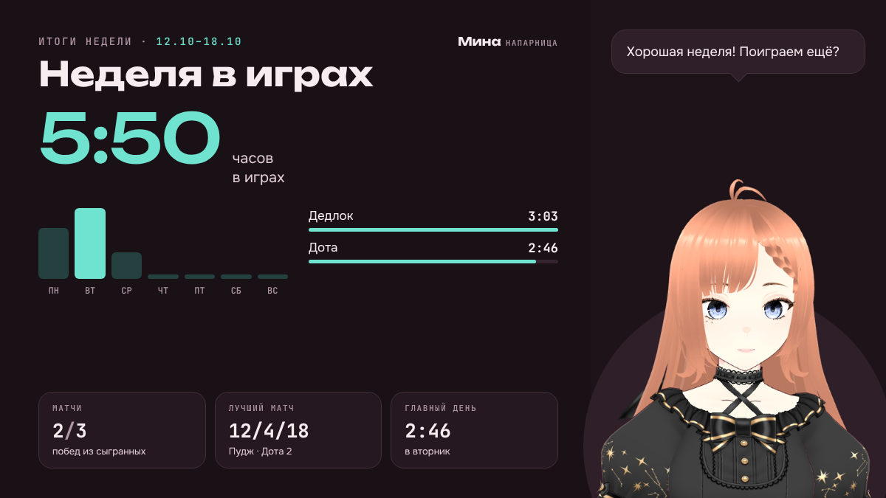

  

<h1 align="center">Мина</h1>

  <b>Живая 3D-напарница на рабочем столе Windows.</b> 
  Слышит голос, помогает с делами и болеет за тебя в играх.

  <a href="https://github.com/Skaarj337/mina/releases/latest"><b>⬇ Скачать для Windows</b></a>
  &nbsp;·&nbsp; бесплатно &nbsp;·&nbsp; Windows 10/11

---

## Что она умеет

**Живёт на рабочем столе.** Гуляет по окнам, садится на панель задач, засыпает ночью, танцует под твою музыку и сама переодевается по погоде. Можно поселить её прямо на обоях — со сводкой дня.

**Разговаривает голосом.** Скажи «Мина, …» — и она ответит. Помогает с делами, заметками, календарём, файлами и Телеграмом. Отправляет что-то только после твоего «да».

**Напарница в играх.** Таймеры голосом («Мина, Рошан упал»), клипы лучших моментов, реакции на матч и разбор после игры. Плюшки для Доты, Лиги, CS2, Дедлока, Валоранта, Path of Exile, Genshin и Star Rail, WoW, Майнкрафта и любой игры в Steam.

**Итоги недели.** Карточка с твоими часами в играх, матчами и лучшей катки — в один клик, чтобы кинуть друзьям в Дискорд.

**Заходит к друзьям.** В голосовой канал Дискорда и в Майнкрафт — отдельным игроком, который ходит за тобой, рубит деревья и защищает.

  

  

## Чем она думает

Мина работает с разными нейросетями — выбираешь при первом запуске и меняешь когда угодно:

| Вариант | Цена |
|---|---|
| Подписка **Claude** (Pro или Max) | уже оплачено — самый умный вариант |
| **OpenRouter**, бесплатные модели | 0 ₽, на пробу: 10–20 разговоров в день |
| **DeepSeek**, GPT, Claude по ключу | платишь только за ответы, от копеек |
| Своя модель на видеокарте (**Ollama**) | бесплатно, нужна мощная видеокарта |
| Пока без интеллекта | работают команды: таймеры, погода, игры, обои |

  

## Установка

1. Скачай `Mina-Setup-….exe` со страницы [последнего выпуска](https://github.com/Skaarj337/mina/releases/latest).
2. Запусти. Если Windows покажет синее окно «Windows защитила компьютер» — нажми **«Подробнее» → «Выполнить в любом случае»**. Так бывает с программами от небольших авторов без платной подписи.
3. Права администратора не нужны. Ставится только Мина — без рекламы и чужих программ.
4. При первом запуске она один раз докачает нужное для работы (~300 МБ) и познакомится с тобой.

Обновления приходят сами: Мина предложит обновиться, когда выйдет новая версия.

**Нужно:** Windows 10 или 11 (64-бит), 8 ГБ памяти, интернет. Для живого голоса пригодится видеокарта NVIDIA, но можно и без неё.

## Приватность

- Настройки, память, заметки и ключи хранятся **только на твоём компьютере**, ключи — зашифрованы средствами Windows.
- Мина отправляет данные только в сервисы, которые ты сам подключил: выбранную нейросеть, голос, Телеграм, Дискорд, игровые сервисы.
- Экран смотрит только по твоей просьбе. Пароли и коды никогда не вводит.
- В играх не лезет в память и файлы игры — только официальные и открытые данные, античит спокоен.

## Вопросы и ошибки

Нашёл баг или есть идея — открой [Issue](https://github.com/Skaarj337/mina/issues) или напиши в Телеграм [@skaarjxd](https://t.me/skaarjxd).

---

  © 2026 Skaarj337. Все права защищены — Мину можно бесплатно использовать, но нельзя продавать и перезаливать. Подробно — в <a href="LICENSE">LICENSE</a>.

